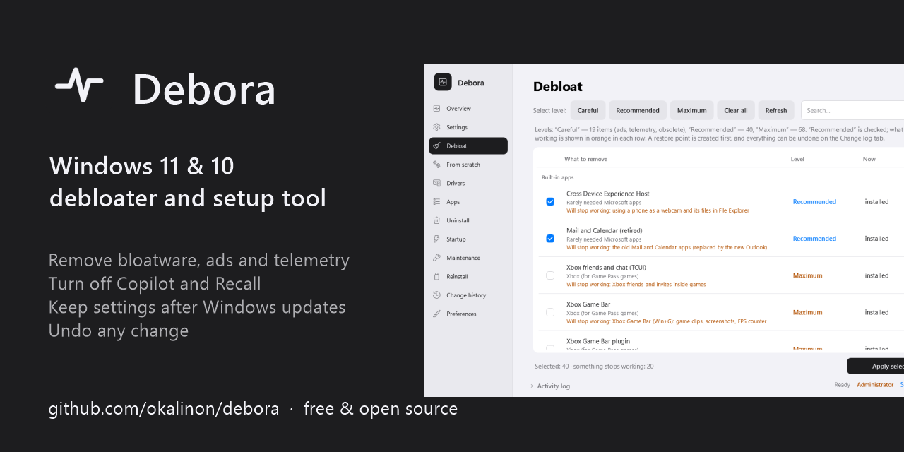
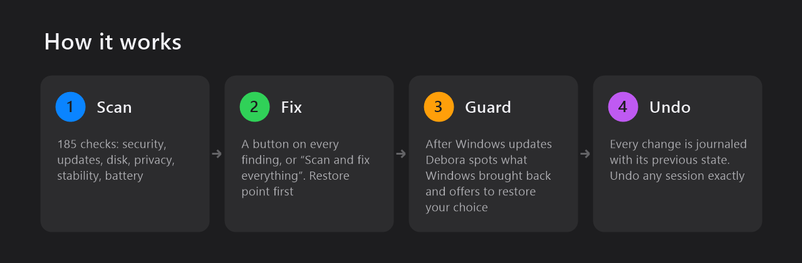
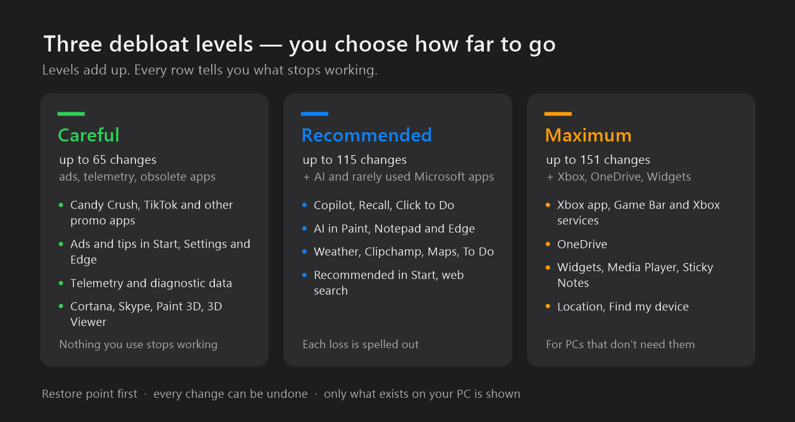
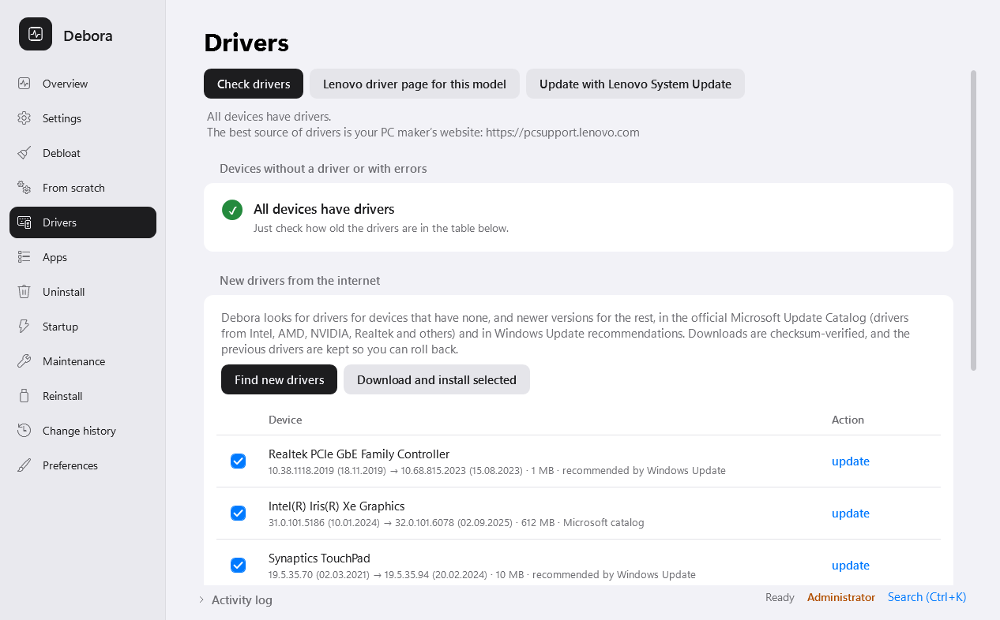
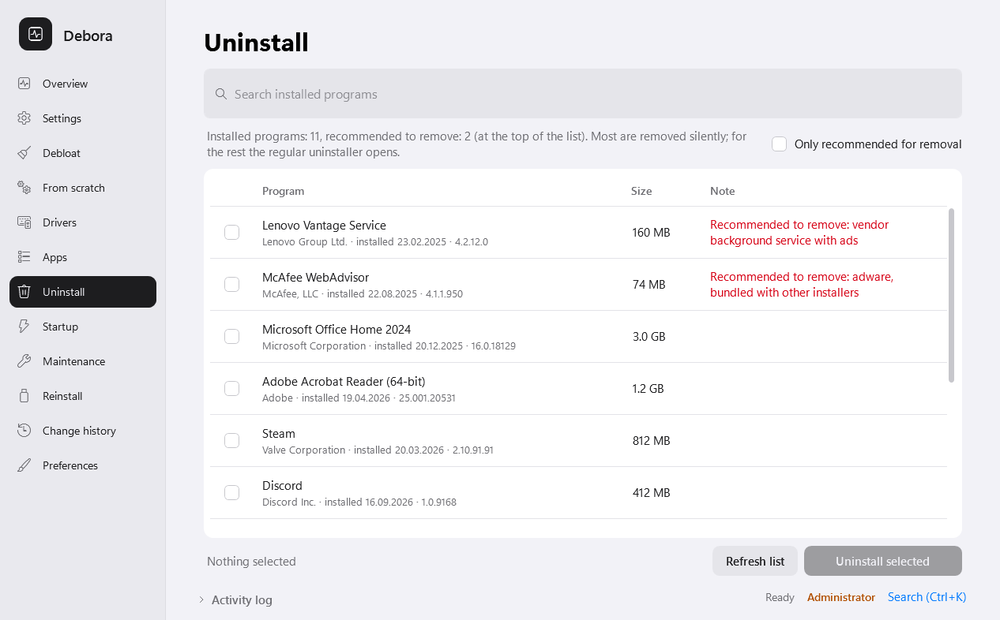
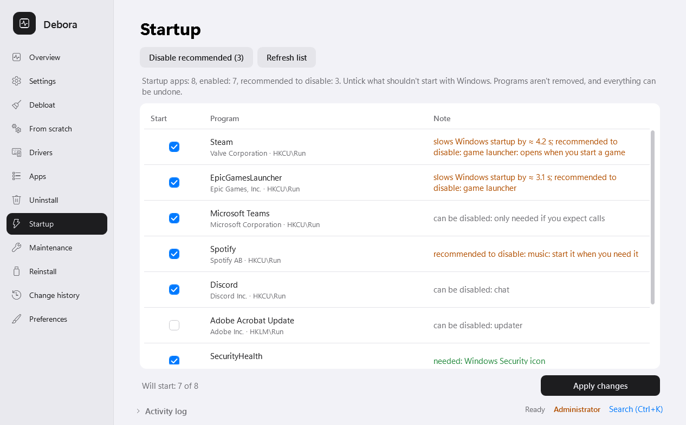
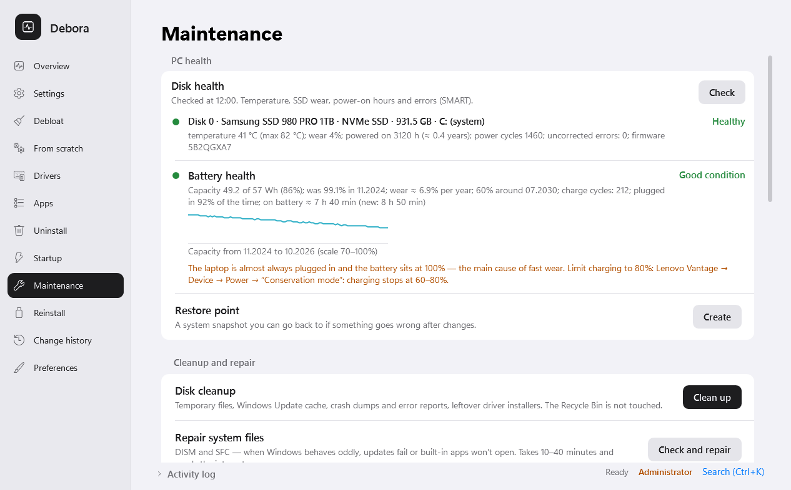
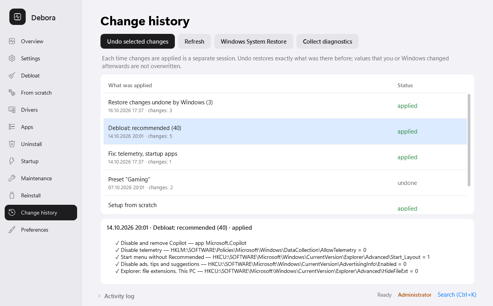

# Debora — Windows 11 & 10 debloater, privacy and setup tool

[](https://github.com/okalinon/debora/releases/latest)
[](https://github.com/okalinon/debora/releases)
[](LICENSE)


**[Українською](README.uk.md)** · [Changelog](CHANGELOG.md) · [Download](https://github.com/okalinon/debora/releases/latest)



Debora removes Windows bloatware, ads and telemetry, turns off Copilot and Recall, sets up a fresh Windows install
in one pass and keeps your PC in shape — and every change can be undone. When a Windows update brings something back,
Debora notices and restores your settings with one click.

| 151 | 185 | 567 | 1 click | 0 |
|:---:|:---:|:---:|:---:|:---:|
| debloat changes in 3 levels | health checks with a 0–100 score | apps to install via winget | to undo any session | bytes of your data sent anywhere |

**Contents:** [What is debloating?](#what-is-debloating-windows) · [How it works](#how-it-works) · [Screenshots](#a-tour-of-debora) · [What exactly changes](#what-exactly-changes) ·
[Download](#download-and-run) · [FAQ](#faq) · [Guides](#guides) · [Command line](#command-line) · [Privacy](#privacy)

## What is debloating Windows?

**Bloatware** is everything that comes with Windows or a new PC but that you never asked for: pre-installed games and
promo apps (Candy Crush, TikTok, trial antivirus), Microsoft apps most people never open, ads and “suggestions” in the
Start menu, Settings and on the lock screen, telemetry that sends usage data to Microsoft, background services and
scheduled tasks, and more recently AI features such as Copilot and Recall.

**Debloating** means removing or turning off that part of Windows, so that you are left with the system you actually
use. It gives you:

- **less noise** — no ads, pop-ups, promoted apps and “finish setting up your device” reminders;
- **more privacy** — less diagnostic and usage data leaves your PC, apps get less access to your data;
- **fewer things running in the background** — fewer services, tasks and startup apps competing for resources,
  which is most noticeable on older and low-end PCs;
- **a cleaner Start menu and disk** — apps you never use are gone.

Debloating is not a magic speed boost, and done carelessly it can hurt: many debloat scripts remove things for good,
break the Microsoft Store, Windows Update or Xbox games, and give no way back. Debora is built around the opposite
approach: it shows what each change does and **what will stop working**, starts with a restore point, records every
change so it can be undone, does not disable Windows Update or remove Edge and the Store, and brings your choices back when a
Windows update reverts them.

## How it works



## A tour of Debora

### PC health scan — one score, a button on every finding

185 checks across security, updates, disk, stability, privacy, performance, cleanliness, network, backup and battery. Each finding
explains the problem in plain words and has a **Fix** button (or a step-by-step guide when only you can decide).
*Scan and fix everything* runs the whole list after one confirmation and scans again. Blue screen codes, crashing
modules and slow boot are explained too. The window follows the Windows light or dark theme.

<picture>
  <source media="(prefers-color-scheme: dark)" srcset="docs/images/overview-dark.png">
  
</picture>

### Debloat — three levels, and you see what you lose



Pick a level or tick items one by one. Every row says **what will stop working** (in orange) before anything is
applied. Only apps and features that exist on your PC are shown; Xbox and the useful apps stay unticked unless you
choose *Maximum*.


### Setup from scratch — a fresh Windows ready in one run

After a clean install: drivers, debloat, settings, apps, Windows updates and scan-and-fix. When updates need a
restart, Debora restarts and continues by itself after you sign in. Save the plan to a file and reuse it on other PCs
or on a reinstall USB stick.


### Drivers — from the official Microsoft catalog, with rollback

Every device with its driver version, date and provider. New drivers come from the Microsoft Update Catalog and
Windows Update recommendations, are checked by SHA-256, and the current driver is exported first so you can roll
back. PC makers' own tools (Dell, Lenovo, HP) are offered when they fit your model.



### Apps and uninstall

Install browsers, messengers, media players, office, gaming, creative and developer tools in one click via winget
(567 apps in 15 categories and ready-made bundles) and keep them updated. Uninstall programs silently where possible,
then clean up their leftovers: folders go to the Recycle Bin, registry keys are backed up first. Adware and vendor
bloat are flagged at the top.

| Install apps | Uninstall programs |
|---|---|
|  |  |

### Startup and maintenance

See which startup programs slow down boot (measured by Windows itself) and which are safe to turn off. Check disk
health (SMART: temperature, wear, errors) and battery wear with a capacity history and advice to limit charging on
your laptop brand. Disk cleanup, system file repair (DISM/SFC), network and Windows Update reset, pausing updates for
7–35 days, weekly automatic maintenance.

| Startup | Disk and battery health |
|---|---|
|  |  |

### Change history — every change can be undone

Each run is a session in the journal with the previous value of everything it touched. Select a session and click
*Undo*: Debora restores exactly what was there before and does not overwrite what you or Windows changed later.
A system restore point is created before changes as a second safety net.



## What exactly changes

| Area | What Debora does | How to undo |
|---|---|---|
| Built-in apps | Removes Store apps for all users and from the Windows image (new accounts don't get them), blocks automatic reinstall of suggested apps | Undo re-registers them while Windows still keeps their files; otherwise Debora names the ones to reinstall from the Microsoft Store |
| Copilot and AI | Removes the Copilot app, sets Windows policies for Copilot, Recall, Click to Do, AI in Paint, Notepad and Edge | Undo removes the policies |
| Ads and suggestions | Turns off tips, “suggested” apps and promotions in Start, Settings, the lock screen, File Explorer and Edge | Undo restores each registry value |
| Telemetry | Lowers diagnostic data, turns off telemetry services and scheduled tasks, advertising ID, feedback requests | Undo restores the previous startup type and values |
| Start, taskbar, Explorer | Optional: no “Recommended” section, no web results in search, file extensions shown, classic context menu | Undo per session |
| Services and tasks | Disables services and tasks you do not use (Xbox, Fax, Maps, Retail Demo…) | Undo restores the startup type |
| Windows features | Optional removal of legacy components (WordPad, PowerShell ISE, Windows Media Player legacy) | Turn back on in Windows Features or undo |

Debora does **not** remove Microsoft Edge or the Microsoft Store and does not disable Windows Update — the scan even
flags a disabled update service and offers to turn it back on.

## Download and run

1. Download **`Debora-<version>.zip`** from [the latest release](https://github.com/okalinon/debora/releases/latest)
   and extract the whole folder.
2. Double-click **Debora.exe** and allow administrator rights.
3. If SmartScreen says *"Windows protected your PC"*, click **More info → Run anyway** (the program is not code-signed
   yet). File checksums are in `SHA256SUMS`.

No installation needed. Requires Windows 10 or 11 with the built-in Windows PowerShell 5.1. Debora checks for updates
once a day and updates itself from this repository (each archive is verified by SHA-256).

## FAQ

### How do I disable Copilot in Windows 11?
Uninstall the Copilot app and set the *TurnOffWindowsCopilot* policy so updates do not bring it back. Debora does
both (plus Recall, Click to Do and AI in Paint, Notepad and Edge) on the *Recommended* debloat level.
Step-by-step: [How to disable Copilot and Recall](docs/guides/disable-copilot-windows-11.md).

### How do I remove bloatware from Windows 11?
Remove the pre-installed Store apps for all users and as provisioned packages, and turn off automatic installation
of suggested apps. Debora lists only the apps present on your PC and says what each one does.
Step-by-step: [How to remove bloatware](docs/guides/remove-bloatware-windows-11.md).

### How do I turn off telemetry and ads in Windows?
Lower diagnostic data to the minimum your edition allows, disable the DiagTrack service and telemetry tasks, the
advertising ID and "suggestions" in Start, Settings and the lock screen.
Step-by-step: [How to turn off telemetry and ads](docs/guides/disable-telemetry-windows-11.md).

### Why did Copilot, ads or removed apps come back after a Windows update?
Feature updates reinstall built-in apps and reset many settings. Debora detects what was turned back on and restores
it in one click or during weekly maintenance.
More: [Keep your settings after Windows updates](docs/guides/windows-updates-reset-settings.md).

### What should I do after a clean install of Windows 11?
Drivers, Windows Update, debloat and privacy, apps, protection — Debora's *From scratch* wizard does it in one run and
continues after restarts. Checklist: [After a clean install](docs/guides/setup-windows-11-after-clean-install.md).

### Is it safe? Can I undo the changes?
Debora creates a system restore point before changes and records the previous value of every registry key, service,
scheduled task and app it touches. *Change history* undoes any session exactly. Nothing is removed without your
confirmation, and the *Careful* level only touches ads, telemetry and obsolete components.

### Which debloat level should I choose?
*Recommended* suits most people: it keeps everything you are likely to use and turns off AI features, ads and
Microsoft apps most people never open. Choose *Careful* on a work PC or if you are unsure. *Maximum* also removes
Xbox, OneDrive and Widgets — skip it if you play Game Pass games or sync files with OneDrive.

### Will games, Xbox or Game Pass stop working?
Not on *Careful* or *Recommended*. Xbox apps and services are only on the *Maximum* level and are unticked by default;
their rows say exactly what stops working (for example, signing in to Xbox in Minecraft or Game Pass games).

### Does Debora remove Microsoft Edge or the Store, or disable Windows Update?
No. Edge is kept but stops nagging (no first-run wizard, default-browser prompts, Copilot button or news on the new
tab page). The Store and Windows Update keep working; you can pause updates for 7–35 days in *Maintenance*.

### Can I choose individual items?
Yes. Levels only tick the boxes for you — untick anything you want to keep, or tick single items without choosing a
level. The same goes for findings, drivers, startup programs and apps.

### Do I need administrator rights or internet?
Debora.exe asks for administrator rights once (most changes need them). Debloat, settings, scan, undo and maintenance
work offline; drivers, apps and Debora's own updates need the internet.

### Does it work on Windows 10?
Yes, on Windows 10 and 11. Items that do not exist on your version are hidden.

### Is Debora free? Does it send any data?
Free and open source (MIT), with no ads or paid version. It sends nothing: it only downloads drivers, apps and its own
updates from official sources (Microsoft, winget, GitHub) — see [Privacy](#privacy).

### My antivirus or SmartScreen warns about Debora. Why?
Debora changes system settings and the program is not code-signed yet, which is what SmartScreen reacts to. The
releases are built from this repository by [GitHub Actions](.github/workflows/release.yml), checksums are in
`SHA256SUMS`, and free code signing through [SignPath Foundation](https://signpath.org) is being set up.

### How do I update Debora?
Debora checks GitHub once a day and shows a bar when a new version is out — one click updates it (the previous
version is kept). You can also check in *Preferences* or run `Debora.exe -Update`.

### Something went wrong?
*Change history → Collect diagnostics* creates a zip — attach it to an
[issue](https://github.com/okalinon/debora/issues).

## Guides

- [How to disable Copilot and Recall in Windows 11](docs/guides/disable-copilot-windows-11.md)
- [How to remove bloatware from Windows 11 and 10](docs/guides/remove-bloatware-windows-11.md)
- [How to turn off telemetry and ads in Windows 11 and 10](docs/guides/disable-telemetry-windows-11.md)
- [Windows update turned settings back on — how to keep them](docs/guides/windows-updates-reset-settings.md)
- [What to do after a clean install of Windows 11 or 10](docs/guides/setup-windows-11-after-clean-install.md)

## Command line

`Debora.exe -Help` lists all commands, for example:

```
Debora.exe -Scan                         # health scan, score and findings
Debora.exe -Debloat -Level Recommended -WhatIf
Debora.exe -Setup -ProfilePath plan.json  # setup from scratch
Debora.exe -Guard -Yes                   # restore what Windows undid
Debora.exe -DriverUpdate -WhatIf
```

## Building from source

```powershell
.\build\Compile.ps1 -Version 1.0.0   # dist\: Debora.ps1, Debora.dat, Debora.exe
.\build\Test-All.ps1                 # Pester tests
.\build\Release.ps1 -Version 1.0.0   # release zip with checksums
.\build\New-Screenshots.ps1          # README screenshots (demo data), then New-Banners.ps1
```

Design notes (Ukrainian) are in [docs/](docs/).

## Privacy

Debora does not collect or send any data about you or your PC. It connects to the internet only to:

- check GitHub once a day for a newer Debora version (only the public release list is requested;
  turn it off in *Preferences → Check for Debora updates*);
- download what you ask for: drivers (Microsoft Update Catalog, Windows Update), programs (winget, GitHub releases)
  and Debora updates.

All logs, reports and the change journal stay on your PC (`%ProgramData%\Debora`, the `Reports` folder).

## Uninstall

Debora is portable: delete its folder. To remove everything else, first turn off weekly maintenance
(*Maintenance → Automatic maintenance → Turn off*, or `Debora.exe -Schedule Off`), then delete `%ProgramData%\Debora`
(journal, logs, backups) and `%LOCALAPPDATA%\Debora` (cache). Changes made to Windows stay until you undo them in
*Change history*.

## Code signing policy

Free code signing provided by [SignPath.io](https://about.signpath.io), certificate by
[SignPath Foundation](https://signpath.org).

- Committers and reviewers: [okalinon](https://github.com/okalinon)
- Approvers: [okalinon](https://github.com/okalinon)

Release binaries (`Debora.exe`, `Debora.ps1`) are built by [GitHub Actions](.github/workflows/release.yml) from
this repository's source, and every signing request is approved manually. Only code from this repository is signed.

## About

Debora is developed in Ukraine by [@okalinon](https://github.com/okalinon). The goal is a free tool that anyone can use safely on
their own PC: every change is explained before it is made and can be undone afterwards. Issues and ideas are welcome.

## License

[MIT](LICENSE)
