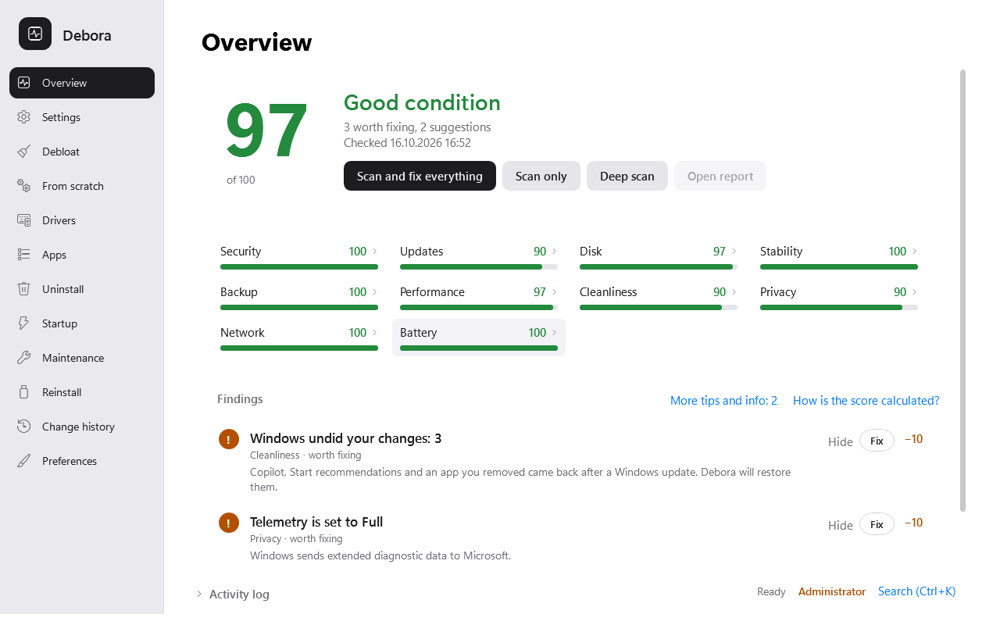
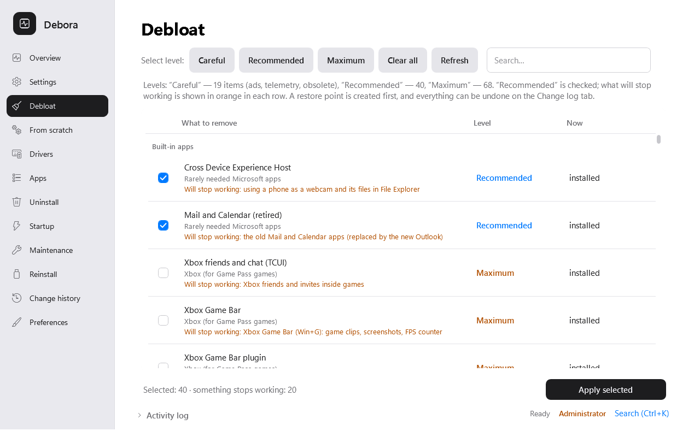
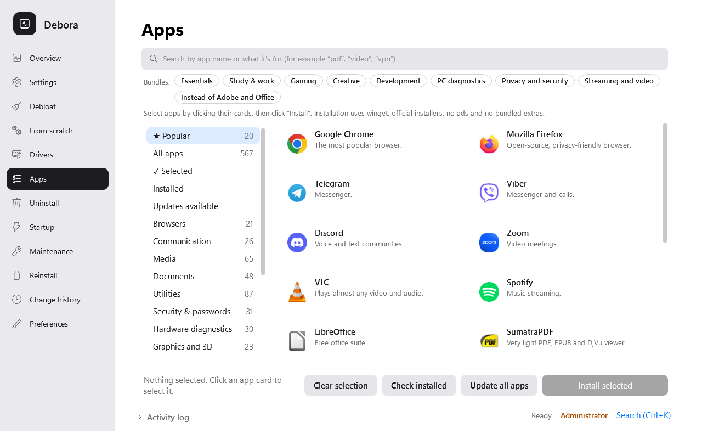
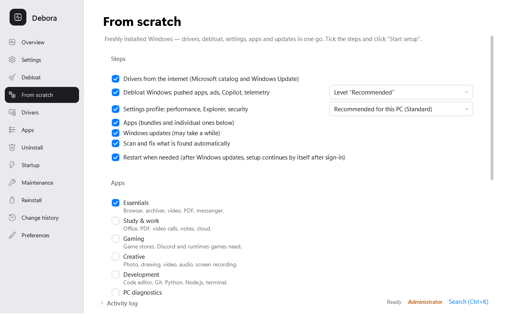

# Debora — Windows 11 & 10 debloater, privacy and setup tool

[](https://github.com/okalinon/debora/releases/latest)
[](https://github.com/okalinon/debora/releases)
[](LICENSE)


**[Українською](README.uk.md)** · [Changelog](CHANGELOG.md) · [Download](https://github.com/okalinon/debora/releases/latest)

Debora removes Windows bloatware, ads and telemetry, turns off Copilot and Recall, sets up a fresh Windows install
in one pass and keeps your PC in shape — and every change can be undone. When a Windows update brings something back,
Debora notices and restores your settings with one click.



## Features

- **Debloat Windows 11 / 10 with three levels** — *Careful* (ads, pushed games, telemetry, obsolete apps),
  *Recommended* (+ Copilot and AI features, Microsoft apps most people never open) and *Maximum* (+ Xbox, OneDrive,
  widgets). Every item tells you **what will stop working** before you apply it.
- **Remove bloatware app by app** — Candy Crush, Clipchamp, Teams, the new Outlook, Phone Link, Xbox, Bing apps and more.
- **Privacy** — disable telemetry, advertising ID, Start menu and lock screen ads, Bing web search, Edge sidebar and
  shopping, app access to contacts, calendar, messages; Copilot, Recall and Click to Do.
- **Changes stay changed** — after Windows updates Debora detects what was turned back on and restores it
  (automatically during weekly maintenance, if you like).
- **Exact undo** — a restore point before changes and a journal of every change with its previous value; undo any session.
- **Setup from scratch** — after a clean install: drivers, debloat, tweaks, apps, Windows Update and scan-and-fix in
  one run; restarts when updates need it and continues after sign-in. Save the plan and reuse it on other PCs.
- **PC health scan** — 185 checks with a 0–100 score: security, updates, disk, stability, privacy, performance,
  battery. Every finding has a **Fix** button or a step-by-step guide. Blue screen codes, crashing modules and slow
  boot are explained in plain language.
- **Drivers** — every device with its driver version; new drivers from the official Microsoft Update Catalog and
  Windows Update, verified by checksum, with backup and rollback.
- **Apps** — install 567 programs via winget in one click (browsers, messengers, media, office, gaming, creative,
  developer tools) and keep them updated; uninstall programs with leftover cleanup.
- **Maintenance** — disk cleanup, SMART disk health, battery wear, startup manager, system file repair (DISM/SFC),
  network and Windows Update reset, weekly automatic maintenance.
- **Reinstall Windows** — prepare a USB stick that installs Windows without questions, adds this PC's drivers and runs
  your setup plan after the first sign-in.
- **English and Ukrainian** interface, light and dark theme, a full command line.

| Debloat levels | Apps |
|---|---|
|  |  |



## Download and run

1. Download **`Debora-<version>.zip`** from [the latest release](https://github.com/okalinon/debora/releases/latest)
   and extract the whole folder.
2. Double-click **Debora.exe** and allow administrator rights.
3. If SmartScreen says *"Windows protected your PC"*, click **More info → Run anyway** (the program is not code-signed
   yet). File checksums are in `SHA256SUMS`.

No installation needed. Requires Windows 10 or 11 with the built-in Windows PowerShell 5.1. Debora checks for updates
once a day and updates itself from this repository (each archive is verified by SHA-256).

## FAQ

**Is it safe?** Debora creates a system restore point before changes and records the previous value of every registry
key, service, scheduled task and app it touches. The *Change history* tab undoes any session exactly. Nothing is
removed without your confirmation, and the *Careful* level only touches ads, telemetry and obsolete components.

**Does it send any data?** No. Debora only downloads drivers, apps and its own updates from official sources
(Microsoft, winget, GitHub).

**Why did Copilot (or ads, or an app) come back?** Windows feature updates re-enable many settings. Debora checks after
every Windows update and offers to restore what you had turned off.

**Windows 10 or 11?** Both. Items that do not exist on your version are hidden.

**Something went wrong?** *Change history → Collect diagnostics* creates a zip — attach it to an
[issue](https://github.com/okalinon/debora/issues).

## Command line

`Debora.exe -Help` lists all commands, for example:

```
Debora.exe -Scan                         # health scan, score and findings
Debora.exe -Debloat -Level Recommended -WhatIf
Debora.exe -Setup -ProfilePath plan.json  # setup from scratch
Debora.exe -Guard -Yes                   # restore what Windows undid
Debora.exe -DriverUpdate -WhatIf
```

## Building from source

```powershell
.\build\Compile.ps1 -Version 1.0.0   # dist\: Debora.ps1, Debora.dat, Debora.exe
.\build\Test-All.ps1                 # Pester tests
.\build\Release.ps1 -Version 1.0.0   # release zip with checksums
```

Design notes (Ukrainian) are in [docs/](docs/).

## License

[MIT](LICENSE)
