# Debora — деблоат, приватність і налаштування Windows 11 та 10

[](https://github.com/okalinon/debora/releases/latest)
[](https://github.com/okalinon/debora/releases)
[](LICENSE)


**[English](README.md)** · [Що нового](CHANGELOG.md) · [Завантажити](https://github.com/okalinon/debora/releases/latest)

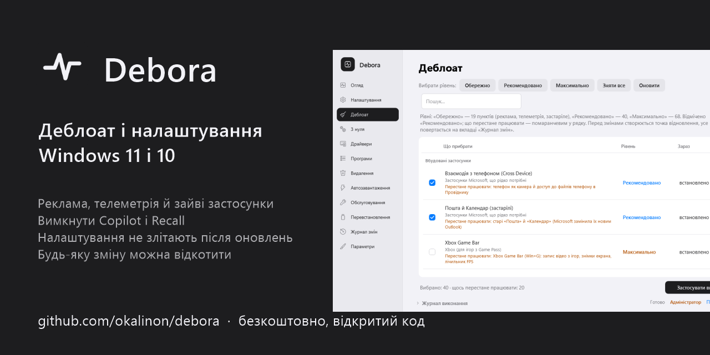

Debora прибирає з Windows нав'язані застосунки, рекламу й телеметрію, вимикає Copilot і Recall, налаштовує щойно
встановлену Windows за один прохід і доглядає за ПК — а кожну зміну можна відкотити. Коли оновлення Windows щось
повертає, Debora це помічає й відновлює ваші налаштування одним кліком.

| 151 | 185 | 567 | 1 клік | 0 |
|:---:|:---:|:---:|:---:|:---:|
| змін деблоату у 3 рівнях | перевірок стану з оцінкою 0–100 | програм для встановлення через winget | щоб відкотити будь-яку сесію | байтів ваших даних кудись |

**Зміст:** [Що таке деблоат?](#що-таке-деблоат-windows) · [Як це працює](#як-це-працює) · [Знімки екрана](#огляд-можливостей) · [Що саме змінюється](#що-саме-змінюється) ·
[Завантаження](#завантаження-й-запуск) · [Питання й відповіді](#питання-й-відповіді) · [Інструкції](#інструкції) ·
[Командний рядок](#командний-рядок) · [Приватність](#приватність)

## Що таке деблоат Windows?

**Bloatware** («роздуте», непотрібне ПЗ) — усе, що приходить разом із Windows чи новим ПК, але про що ви не просили:
попередньо встановлені ігри й рекламні застосунки (Candy Crush, TikTok, пробні антивіруси), застосунки Microsoft, які
мало хто відкриває, реклама й «пропозиції» в «Пуску», Параметрах і на екрані блокування, телеметрія, що надсилає
Microsoft дані про використання, фонові служби й завдання, а останнім часом — функції ШІ на кшталт Copilot і Recall.

**Деблоат** (від англ. *debloat* — «прибрати роздуте») — це видалення або вимкнення цієї частини Windows, щоб лишилась
система, якою ви справді користуєтесь. Що це дає:

- **менше шуму** — без реклами, спливаючих вікон, нав'язаних застосунків і нагадувань «завершіть налаштування пристрою»;
- **більше приватності** — менше діагностичних даних і даних про використання залишає ваш ПК, застосунки мають менше
  доступу до ваших даних;
- **менше фонових процесів** — менше служб, завдань і програм в автозавантаженні змагаються за ресурси; найпомітніше це
  на старих і слабких ПК;
- **чистіший «Пуск» і диск** — застосунків, якими ви не користуєтесь, більше немає.

Деблоат — не чарівне прискорення, а зроблений недбало — може зашкодити: багато скриптів видаляють назавжди, ламають
Microsoft Store, Windows Update чи ігри Xbox і не дають шляху назад. Debora побудована навпаки: показує, що робить кожна
зміна і **що перестане працювати**, починає з точки відновлення, записує кожну зміну, щоб її можна було відкотити, не
вимикає Windows Update, не видаляє Edge і Store та повертає ваш вибір, коли оновлення Windows його скасовує.

## Як це працює

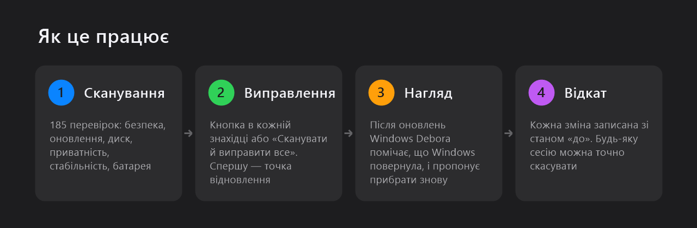

## Огляд можливостей

### Перевірка стану ПК — одна оцінка й кнопка біля кожної знахідки

185 перевірок: безпека, оновлення, диск, стабільність, приватність, швидкодія, чистота, мережа, резервні копії й
батарея. Кожна знахідка пояснює проблему людською мовою й має кнопку «Виправити» (або покрокову інструкцію, коли
рішення за вами). «Сканувати й виправити все» виконує весь перелік після одного підтвердження й сканує знову. Коди
синіх екранів, модулі, в яких падають програми, і причини повільного запуску теж пояснюються. Вікно підлаштовується
під світлу чи темну тему Windows.

<picture>
  <source media="(prefers-color-scheme: dark)" srcset="docs/images/uk/overview-dark.png">
  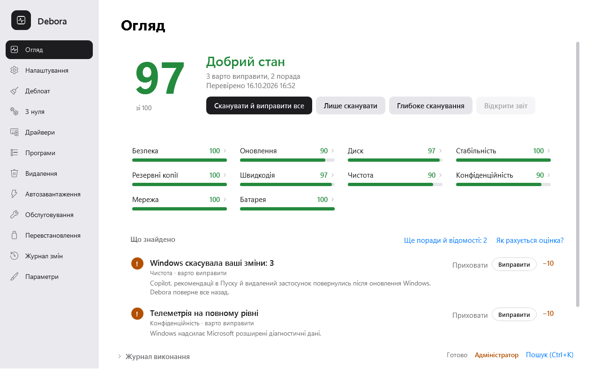
</picture>

### Деблоат — три рівні, і видно, що втрачаєте

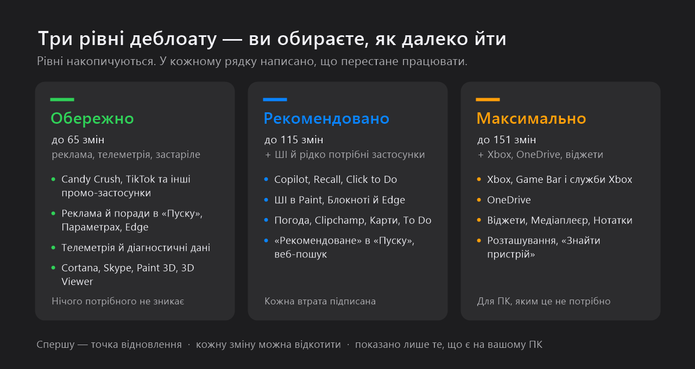

Оберіть рівень або відмітьте пункти поштучно. У кожному рядку помаранчевим написано, **що перестане працювати**, ще
до застосування. Показано лише застосунки й функції, які є на вашому ПК; Xbox і корисні застосунки не відмічені, доки
ви не оберете «Максимально».

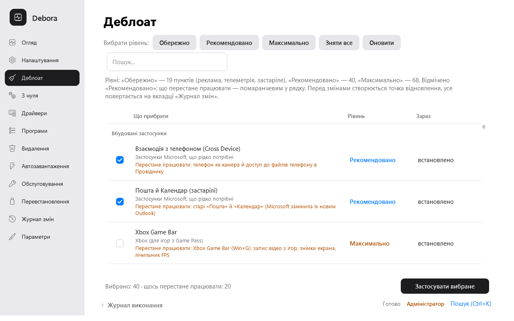

### Налаштування з нуля — свіжа Windows готова за один запуск

Після чистого встановлення: драйвери, деблоат, налаштування, програми, оновлення Windows і перевірка з виправленням.
Коли оновлення вимагають перезавантаження, Debora перезавантажує ПК і сама продовжує після входу. План зберігається у
файл — його можна використати на інших ПК або на флешці перевстановлення.

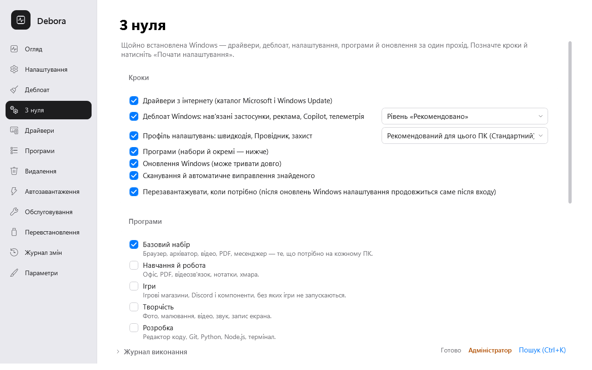

### Драйвери — з офіційного каталогу Microsoft, з відкатом

Усі пристрої з версією, датою й постачальником драйвера. Нові драйвери — з каталогу Microsoft Update і рекомендацій
Windows Update, з перевіркою SHA-256; поточний драйвер спершу експортується, тож його можна повернути. Фірмові утиліти
виробників (Dell, Lenovo, HP) пропонуються, коли підходять вашій моделі.

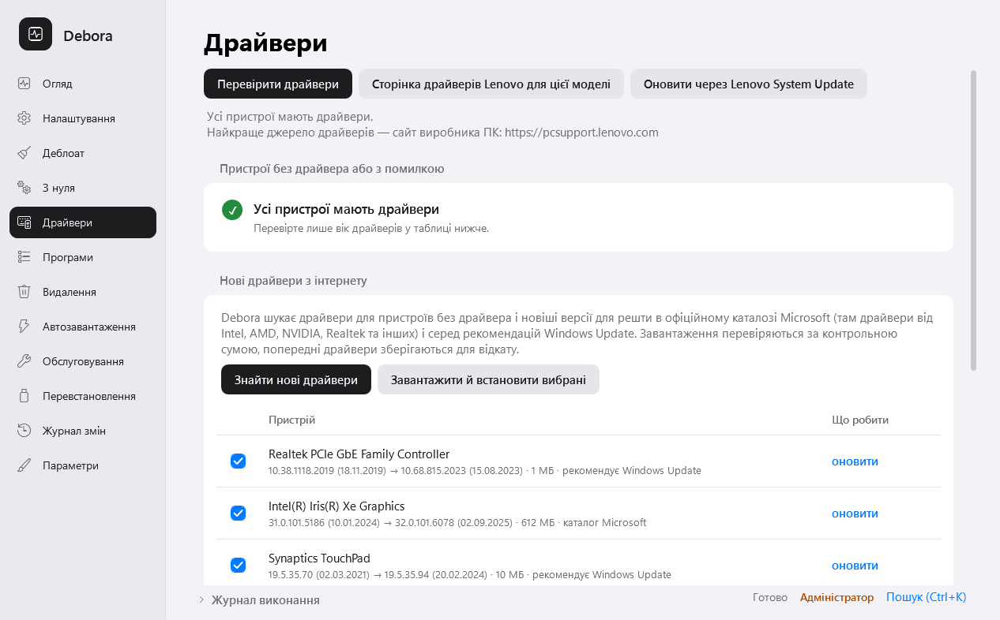

### Програми й видалення

Браузери, месенджери, медіа, офіс, ігри, графіка й засоби розробника в один клік через winget (567 програм у 15
категоріях і готові набори) з оновленням встановлених. Програми видаляються тихо, де це можливо, а потім прибираються
залишки: папки — у Кошик, ключі реєстру — після резервної копії. Рекламне ПЗ й «помічники» виробника — вгорі списку.

| Встановлення програм | Видалення програм |
|---|---|
| 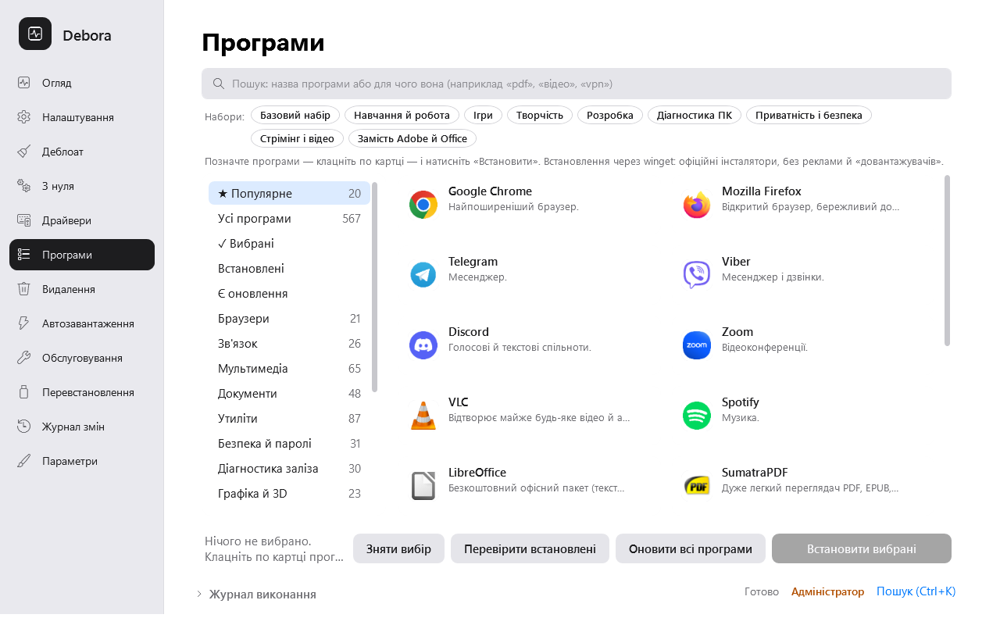 | 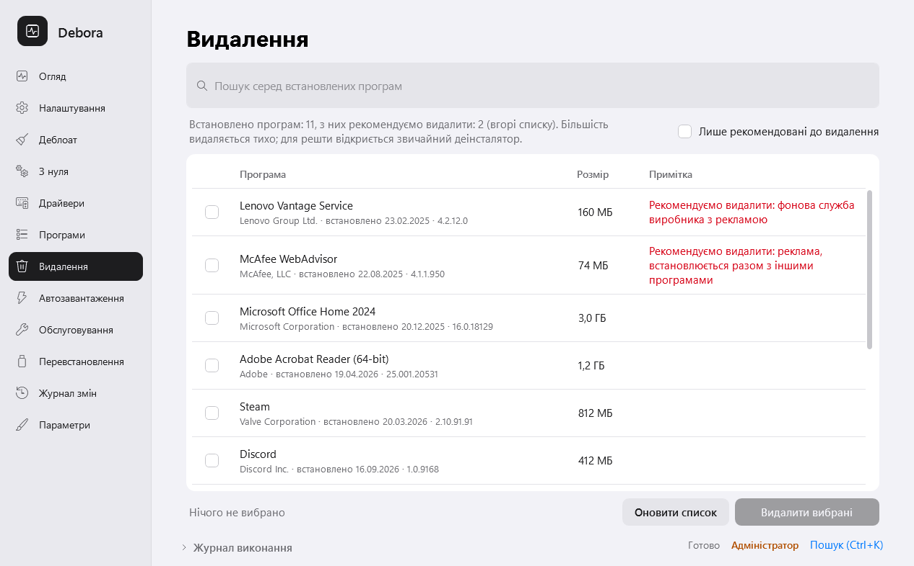 |

### Автозавантаження й обслуговування

Видно, які програми в автозавантаженні сповільнюють запуск (за вимірами самої Windows) і що можна безпечно вимкнути.
Стан дисків (SMART: температура, знос, помилки) і зношення батареї з історією ємності та порадою, як обмежити заряд на
ноутбуці вашого виробника. Очищення диска, відновлення системних файлів (DISM/SFC), скидання мережі й Windows Update,
пауза оновлень на 7–35 днів, автоматичне обслуговування раз на тиждень.

| Автозавантаження | Стан дисків і батареї |
|---|---|
| 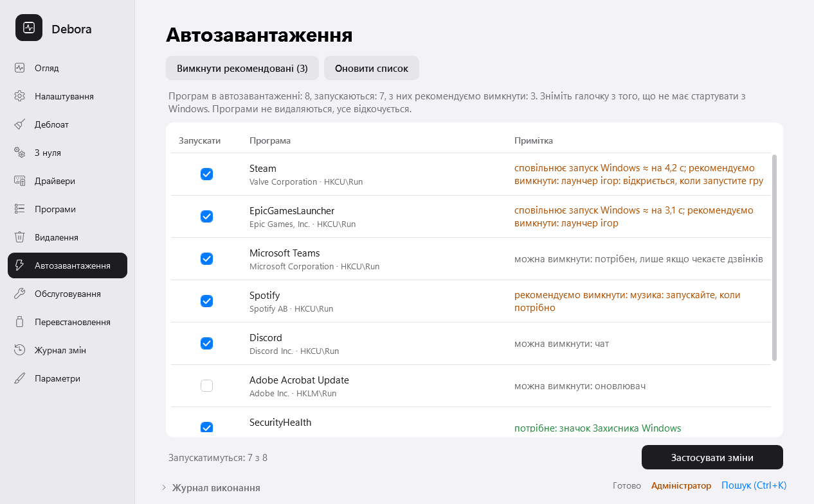 | 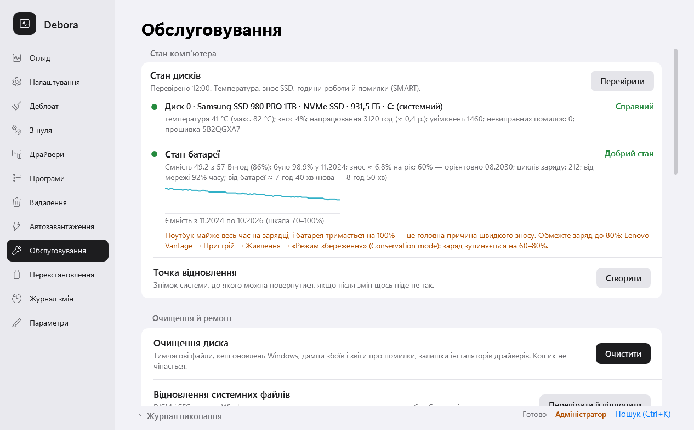 |

### Журнал змін — кожну зміну можна відкотити

Кожен запуск — окрема сесія в журналі з попереднім значенням усього, що вона змінила. Оберіть сесію й натисніть
«Відкотити»: Debora поверне саме те, що було, і не перезапише того, що ви чи Windows змінили пізніше. Перед змінами
створюється ще й точка відновлення системи.

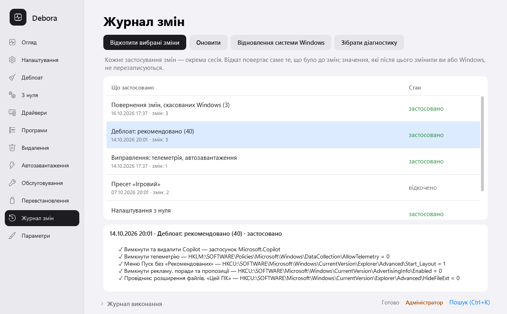

## Що саме змінюється

| Що | Що робить Debora | Як повернути |
|---|---|---|
| Вбудовані застосунки | Видаляє застосунки Store для всіх користувачів і з образу Windows (нові облікові записи їх не отримають), забороняє автоматичне встановлення «рекомендованих» | Відкат реєструє їх знову, поки Windows зберігає їхні файли; інакше Debora назве ті, що треба поставити з Microsoft Store |
| Copilot і ШІ | Видаляє застосунок Copilot, задає політики Windows для Copilot, Recall, Click to Do, ШІ в Paint, Блокноті й Edge | Відкат прибирає політики |
| Реклама й «пропозиції» | Вимикає поради, «рекомендовані» застосунки й рекламу в «Пуску», Параметрах, на екрані блокування, у Провіднику й Edge | Відкат повертає кожне значення реєстру |
| Телеметрія | Знижує діагностичні дані, вимикає служби й завдання телеметрії, рекламний ідентифікатор, запити відгуків | Відкат повертає попередній тип запуску й значення |
| «Пуск», панель задач, Провідник | За бажанням: без розділу «Рекомендоване», без веб-результатів у пошуку, розширення файлів, класичне контекстне меню | Відкат сесії |
| Служби й завдання | Вимикає служби й завдання, якими ви не користуєтесь (Xbox, факс, карти, демо-режим магазину…) | Відкат повертає тип запуску |
| Компоненти Windows | За бажанням — застарілі компоненти (WordPad, PowerShell ISE, старий Windows Media Player) | Увімкнути в «Компонентах Windows» або відкотити |

Debora **не** видаляє Microsoft Edge і Microsoft Store і не вимикає Windows Update — перевірка навіть помічає вимкнену
службу оновлень і пропонує ввімкнути її назад.

## Завантаження й запуск

1. Завантажте **`Debora-<версія>.zip`** з [останнього релізу](https://github.com/okalinon/debora/releases/latest)
   і розпакуйте всю папку.
2. Двічі клацніть **Debora.exe** і погодьтеся надати права адміністратора.
3. Якщо SmartScreen напише «Windows захистила ваш ПК» — **«Додаткові відомості» → «Виконати все одно»** (програма поки
   без цифрового підпису). Контрольні суми файлів — у `SHA256SUMS`.

Встановлювати нічого не треба. Потрібна Windows 10 або 11 із вбудованим Windows PowerShell 5.1. Раз на добу Debora
перевіряє оновлення й оновлюється сама з цього репозиторію (кожен архів перевіряється за SHA-256).

## Питання й відповіді

### Як вимкнути Copilot у Windows 11?
Видаліть застосунок Copilot і задайте політику *TurnOffWindowsCopilot*, щоб оновлення його не повертали. Debora робить
і те, й інше (а також Recall, Click to Do і ШІ в Paint, Блокноті й Edge) на рівні деблоату «Рекомендовано».
Покроково: [Як вимкнути Copilot і Recall](docs/guides/uk/disable-copilot-windows-11.md).

### Як прибрати непотрібні застосунки з Windows 11?
Видаліть попередньо встановлені застосунки для всіх користувачів і з образу та вимкніть автоматичне встановлення
«рекомендованих». Debora показує лише ті застосунки, що є на вашому ПК, і пояснює кожен.
Покроково: [Як прибрати bloatware](docs/guides/uk/remove-bloatware-windows-11.md).

### Як вимкнути телеметрію й рекламу в Windows?
Знизьте діагностичні дані до мінімуму, дозволеного редакцією, вимкніть службу DiagTrack і завдання телеметрії,
рекламний ідентифікатор і «пропозиції» в Пуску, Параметрах і на екрані блокування.
Покроково: [Як вимкнути телеметрію й рекламу](docs/guides/uk/disable-telemetry-windows-11.md).

### Чому після оновлення Windows повернулися Copilot, реклама чи видалені застосунки?
Великі оновлення перевстановлюють вбудовані застосунки й скидають багато налаштувань. Debora знаходить, що ввімкнулося
знову, і повертає одним кліком або під час щотижневого обслуговування.
Детальніше: [Як зберегти налаштування після оновлень Windows](docs/guides/uk/windows-updates-reset-settings.md).

### Що зробити після чистого встановлення Windows 11?
Драйвери, оновлення, деблоат і приватність, програми, захист — майстер «З нуля» робить це за один запуск і продовжує
після перезавантажень. Перелік: [Після чистого встановлення](docs/guides/uk/setup-windows-11-after-clean-install.md).

### Чи це безпечно? Чи можна відкотити зміни?
Перед змінами Debora створює точку відновлення й записує попереднє значення кожного ключа реєстру, служби, завдання й
застосунку, які змінює. «Журнал змін» точно відкочує будь-яку сесію. Без вашого підтвердження нічого не видаляється, а
рівень «Обережно» торкається лише реклами, телеметрії й застарілого.

### Який рівень деблоату обрати?
«Рекомендовано» підходить більшості: лишає все, чим ви ймовірно користуєтесь, і вимикає ШІ, рекламу й застосунки
Microsoft, які мало хто відкриває. «Обережно» — для робочого ПК або коли сумніваєтесь. «Максимально» прибирає ще й
Xbox, OneDrive і віджети — не обирайте його, якщо граєте в ігри Game Pass чи синхронізуєте файли через OneDrive.

### Чи перестануть працювати ігри, Xbox чи Game Pass?
На рівнях «Обережно» й «Рекомендовано» — ні. Застосунки й служби Xbox є лише на рівні «Максимально» і типово не
відмічені; у їхніх рядках написано, що саме перестане працювати (наприклад, вхід в Xbox у Minecraft чи іграх Game Pass).

### Debora видаляє Microsoft Edge чи Store або вимикає Windows Update?
Ні. Edge лишається, але перестає набридати (без майстра першого запуску, пропозицій зробити його браузером за
замовчуванням, кнопки Copilot і новин на новій вкладці). Store і Windows Update працюють; оновлення можна призупинити
на 7–35 днів у розділі «Обслуговування».

### Чи можна обрати окремі пункти?
Так. Рівні лише ставлять галочки за вас — зніміть те, що хочете залишити, або відмітьте окремі пункти без рівня.
Так само зі знахідками, драйверами, автозавантаженням і програмами.

### Чи потрібні права адміністратора й інтернет?
Debora.exe один раз просить права адміністратора (більшість змін без них неможливі). Деблоат, налаштування,
перевірка, відкат і обслуговування працюють без інтернету; драйвери, програми й оновлення Debora — з інтернетом.

### Чи працює на Windows 10?
Так, на Windows 10 і 11. Пункти, яких у вашій версії немає, приховано.

### Чи безкоштовна Debora? Чи надсилає вона якісь дані?
Безкоштовна й з відкритим кодом (MIT), без реклами й платної версії. Нічого не надсилає: лише завантажує драйвери,
програми й власні оновлення з офіційних джерел (Microsoft, winget, GitHub) — див. [Приватність](#приватність).

### Антивірус чи SmartScreen попереджає про Debora. Чому?
Debora змінює системні налаштування, а програма поки без цифрового підпису — на це й реагує SmartScreen. Релізи
збирає [GitHub Actions](.github/workflows/release.yml) з коду цього репозиторію, контрольні суми — у `SHA256SUMS`, а
безкоштовний підпис через [SignPath Foundation](https://signpath.org) зараз налаштовується.

### Як оновити Debora?
Раз на добу Debora перевіряє GitHub і показує смугу, коли вийшла нова версія, — оновлення в один клік (попередня версія
зберігається). Перевірити можна й у «Параметрах» або командою `Debora.exe -Update`.

### Щось пішло не так?
«Журнал змін» → «Зібрати діагностику» створить zip — додайте його до
[issue](https://github.com/okalinon/debora/issues).

## Інструкції

- [Як вимкнути Copilot і Recall у Windows 11](docs/guides/uk/disable-copilot-windows-11.md)
- [Як прибрати непотрібні застосунки з Windows 11 і 10](docs/guides/uk/remove-bloatware-windows-11.md)
- [Як вимкнути телеметрію й рекламу в Windows 11 і 10](docs/guides/uk/disable-telemetry-windows-11.md)
- [Оновлення Windows повернуло налаштування — як їх зберегти](docs/guides/uk/windows-updates-reset-settings.md)
- [Що зробити після чистого встановлення Windows 11 або 10](docs/guides/uk/setup-windows-11-after-clean-install.md)

## Командний рядок

`Debora.exe -Help` показує всі команди, наприклад:

```
Debora.exe -Scan                          # перевірка стану, оцінка й знахідки
Debora.exe -Debloat -Level Recommended -WhatIf
Debora.exe -Setup -ProfilePath plan.json   # налаштування з нуля
Debora.exe -Guard -Yes                    # повернути те, що скасувала Windows
Debora.exe -DriverUpdate -WhatIf
```

## Збірка з вихідного коду

```powershell
.\build\Compile.ps1 -Version 1.0.0   # dist\: Debora.ps1, Debora.dat, Debora.exe
.\build\Test-All.ps1                 # тести Pester
.\build\Release.ps1 -Version 1.0.0   # архів релізу з контрольними сумами
.\build\New-Screenshots.ps1 -Lang uk # знімки для README (демо-дані), потім New-Banners.ps1
```

Технічна документація — у [docs/](docs/) (почніть з [архітектури](docs/03-architecture.md) і
[командного рядка](docs/08-cli.md)).

## Приватність

Debora не збирає й не надсилає жодних даних про вас чи ваш ПК. В інтернет вона звертається лише для того, щоб:

- раз на добу перевірити на GitHub, чи є новіша версія Debora (запитується лише публічний список релізів;
  вимикається в «Параметрах» → «Перевіряти оновлення Debora»);
- завантажити те, що ви просите: драйвери (каталог Microsoft Update, Windows Update), програми (winget, релізи GitHub)
  і оновлення Debora.

Журнали, звіти й журнал змін лишаються на вашому ПК (`%ProgramData%\Debora`, папка «Звіти»).

## Видалення

Debora не встановлюється — достатньо видалити її папку. Щоб прибрати все інше, спершу вимкніть щотижневе
обслуговування («Обслуговування» → автоматичне обслуговування → «Вимкнути» або `Debora.exe -Schedule Off`), потім видаліть
`%ProgramData%\Debora` (журнал, логи, резервні копії) і `%LOCALAPPDATA%\Debora` (кеш). Зміни, внесені у Windows,
лишаються, доки ви не відкотите їх у «Журналі змін».

## Підпис коду

Безкоштовний підпис коду надає [SignPath.io](https://about.signpath.io), сертифікат —
[SignPath Foundation](https://signpath.org).

- Автори й рецензенти: [okalinon](https://github.com/okalinon)
- Затверджувачі: [okalinon](https://github.com/okalinon)

Файли релізу (`Debora.exe`, `Debora.ps1`) збирає [GitHub Actions](.github/workflows/release.yml) з коду цього
репозиторію, а кожен запит на підпис затверджується вручну. Підписується лише код із цього репозиторію.

## Про проєкт

Debora розробляється в Україні — [@okalinon](https://github.com/okalinon). Мета — безкоштовний інструмент, яким будь-хто може
безпечно користуватися на своєму ПК: кожну зміну пояснено до її виконання, і її можна відкотити. Повідомлення про
проблеми й ідеї — вітаються.

## Ліцензія

[MIT](LICENSE)
