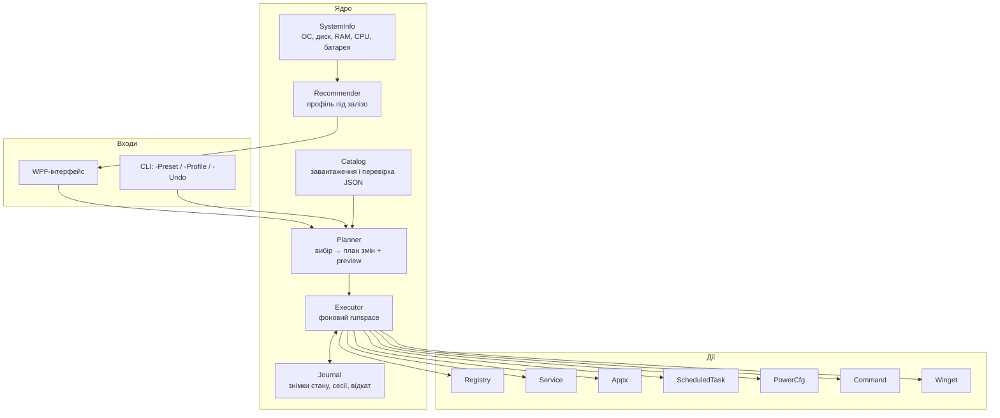

# 3. Архітектура

## Стек

| Шар | Технологія | Чому |
|---|---|---|
| Мова | PowerShell 5.1 | Є на кожній Windows 10/11, повний доступ до реєстру, служб, Appx, CIM |
| Інтерфейс | WPF (XAML), завантажений через `System.Windows.Markup.XamlReader` | Сучасний вигляд, темна тема, DPI-масштабування; без компіляції |
| Дані | JSON у `config/` | Твіки й каталоги як дані, перевірка за JSON Schema |
| Тести | Pester 5 | Стандарт для PowerShell |
| Встановлення програм | winget | Вбудований у Windows 10 22H2+/11 |

Альтернатива (C# / .NET 8 + WinUI) розглянута в [ADR-001](adr/ADR-001-stack.md).

## Шари



Правило залежностей: **інтерфейс і CLI знають лише ядро; ядро знає лише інтерфейс дій**. Кожен тип дії — окремий модуль з однаковим контрактом (див. [Модель твіків](04-tweak-model.md#контракт-дії)).

## Структура репозиторію

```
Debora/
├─ src/
│  ├─ Main.ps1                 # точка входу: параметри, права адміністратора, вибір UI/CLI
│  ├─ core/
│  │  ├─ SystemInfo.ps1        # Get-D9SystemInfo
│  │  ├─ Recommender.ps1       # Get-D9RecommendedPreset
│  │  ├─ Catalog.ps1           # Import-D9Catalog, Test-D9Catalog (схема)
│  │  ├─ Planner.ps1           # New-D9Plan, Get-D9Preview
│  │  ├─ Executor.ps1          # Invoke-D9Plan (runspace, прогрес, скасування)
│  │  ├─ Journal.ps1           # New-D9Session, Add-D9Snapshot, Undo-D9Session
│  │  ├─ Localization.ps1      # Get-D9String
│  │  └─ Log.ps1
│  ├─ actions/
│  │  ├─ Registry.ps1   ├─ Service.ps1   ├─ Appx.ps1
│  │  ├─ ScheduledTask.ps1 ├─ PowerCfg.ps1 ├─ Command.ps1
│  │  └─ Winget.ps1
│  ├─ ui/
│  │  ├─ MainWindow.xaml       # оболонка, навігація, тема
│  │  ├─ tabs/*.xaml           # Огляд, Твіки, Застосунки, Встановлення, Обслуговування, Журнал
│  │  ├─ MainWindow.ps1        # прив'язка подій, ViewModel-хеші
│  │  └─ Dispatcher.ps1        # міст runspace ↔ UI-потік
│  └─ cli/
│     └─ Cli.ps1
├─ config/
│  ├─ tweaks.json              # твіки
│  ├─ appx.json                # вбудовані застосунки: id, назва, безпечно видаляти?
│  ├─ install.json             # каталог програм для winget
│  ├─ presets.json             # профілі
│  ├─ locales/uk.json, en.json
│  └─ schema/*.schema.json
├─ build/
│  ├─ Compile.ps1              # збирає dist/Debora.ps1
│  └─ Sign.ps1
├─ tests/                      # Pester
├─ dist/                       # артефакти збірки (не в git)
└─ docs/
```

## Потік виконання

1. **Старт.** `Main.ps1` перевіряє права адміністратора (перезапуск з UAC за потреби), STA-режим і версію PowerShell.
2. **Каталог.** Вбудовані під час збірки JSON-файли розбираються й перевіряються за схемою. Невалідний твік вимикається з попередженням, а не ламає запуск.
3. **Система.** `SystemInfo` збирає ОС, тип диска (`Get-PhysicalDisk` → MediaType), RAM, CPU, батарею, UEFI/GPT.
4. **Стан.** Для кожного твіка викликається `Test` — інтерфейс показує, що вже застосовано. Перевірки йдуть у фоні, вікно відкривається одразу.
5. **Рекомендація.** `Recommender` за правилами (див. [Каталог](06-catalog.md#профілі)) пропонує профіль.
6. **План.** Вибір користувача → `Planner` будує список атомарних дій і preview.
7. **Виконання.** `Executor` у фоновому runspace: точка відновлення → для кожної дії `Snapshot` → `Apply` → `Test`. Прогрес і журнал передаються в UI через `Dispatcher.Invoke`.
8. **Журнал.** Сесія зберігається в `%ProgramData%\Debora\sessions\<дата>-<id>.json` — з неї працює відкат.

## Багатопотоковість

- WPF живе в головному STA-потоці.
- Виконання — в окремому `Runspace` з тими ж функціями (передаються через `InitialSessionState`).
- Спільний стан — `[hashtable]::Synchronized(@{})`: прогрес, прапор скасування, черга повідомлень.
- Скасування: прапор перевіряється між діями; поточна дія завершується, решта — ні.

## Збірка в один файл

`build/Compile.ps1`:
1. Конкатенує `src/**/*.ps1` у фіксованому порядку (core → actions → ui → cli → Main).
2. Вбудовує `config/*.json` і `ui/**/*.xaml` як here-string змінні (`$D9Embedded['tweaks.json'] = @'...'@`).
3. Пише `dist/Debora.ps1` (UTF-8 з BOM — інакше PowerShell 5.1 ламає кирилицю) і `SHA256SUMS`.
4. Опційно: підпис Authenticode, `.exe` через ps2exe.

## Розповсюдження

- GitHub Releases: `Debora.ps1`, `Debora.exe`, `run.bat`, `SHA256SUMS`.
- Однорядковий запуск як у WinUtil (`irm <url> | iex`) — можливий, але в документації рекомендуємо завантажувати файл і перевіряти хеш.
