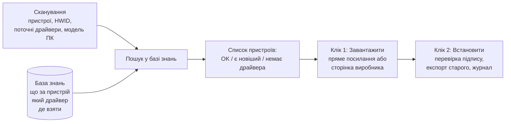

# 13. Менеджер драйверів: база знань «що завантажити і де»

Замість Windows Update — власна система на кшталт Driver Identifier. Утиліта **не зберігає і не перерозповсюджує драйвери**. Вона має **базу знань**: для кожного пристрою — що це за пристрій, який драйвер потрібен і **звідки його взяти** (офіційний сайт), так щоб людина отримала драйвер за **1–2 кліки**.

> Замінює підхід «оновлення з Windows Update» з [Драйвери](11-drivers.md). Флешка з власними драйверами (режими 1–3 звідти) лишається як додаткова можливість.

## Як працює



## 1. Сканування (без інтернету, 2–5 с)

- Пристрої: `Win32_PnPEntity` → назва, клас, **Hardware ID** і **Compatible ID**, код помилки.
- Поточні драйвери: `Win32_PnPSignedDriver` → версія, дата, виробник, підписант.
- Модель ПК: виробник, модель, SKU, серійний номер (для сторінок Dell / HP / Lenovo, які відкриваються за серійним номером).

## 2. База знань

Три шари, від загального до точного. Усе — текстові JSON-файли в репозиторії (`knowledge/`), які оновлюються разом з утилітою або окремо з GitHub. Жодних файлів драйверів.

### Шар 1 — «що це за пристрій»
Навіть пристрій без драйвера («Невідомий пристрій») має Hardware ID, наприклад `PCI\VEN_168C&DEV_0042`. З публічних баз ідентифікаторів визначаємо виробника і модель чипа:

| Джерело | Що дає | Ліцензія |
|---|---|---|
| [pci.ids](https://pci-ids.ucw.cz/) | `VEN_168C&DEV_0042` → Qualcomm Atheros QCA9377 Wi-Fi | GPL / BSD 3-clause |
| [usb.ids](http://www.linux-usb.org/usb.ids) | USB-пристрої (`VID_xxxx&PID_xxxx`) | GPL / BSD 3-clause |
| ACPI / HDAUDIO / власна таблиця | `ACPI\ENEE3000` → ENE Serial IO; `HDAUDIO\FUNC_01&VEN_10EC&DEV_0255` → Realtek ALC255 | наша |

Результат: людина бачить «Wi-Fi Qualcomm Atheros QCA9377», а не «Мережевий контролер ⚠».

### Шар 2 — «де взяти» (правила джерел)
Для кожного виробника чипа і кожного виробника ПК — **як отримати драйвер за 1–2 кліки**:

| Виробник | Правило | Що відкривається |
|---|---|---|
| **Виробник ПК** (Acer, Lenovo, Dell, HP, Asus, MSI…) | Шаблон посилання з моделлю або серійним номером | Сторінка драйверів **саме цієї моделі**, ОС вже вибрана |
| Intel (`VEN_8086`) | Пошук на Intel Download Center за назвою пристрою; Intel Driver & Support Assistant | Сторінка драйвера або завантаження DSA |
| NVIDIA (`VEN_10DE`) | Сторінка пошуку драйвера з серією GPU | Офіційний драйвер / NVIDIA App |
| AMD (`VEN_1002`, `VEN_1022`) | Сторінка підтримки AMD для серії; AMD Auto-Detect | Офіційний драйвер / утиліта автовизначення |
| Realtek (`VEN_10EC`) | Сторінка драйверів для класу (LAN, аудіо, кардрідер) | Офіційна сторінка Realtek |
| Будь-який | Microsoft Update Catalog за HWID | Список підписаних драйверів саме для цього ID — версію вибираєте ви |

Пріоритет: **виробник ПК** (фірмові драйвери звуку, тачпада, гарячих клавіш) → **виробник чипа** → **Microsoft Update Catalog**.

### Шар 3 — «точна відповідь» (перевірені записи)
Для поширених пристроїв — готові записи з **прямим офіційним посиланням на файл**: клік — і завантаження почалось.

```json
{
  "match": ["PCI\\VEN_168C&DEV_0042&SUBSYS_0806105B", "PCI\\VEN_168C&DEV_0042"],
  "device": "Qualcomm Atheros QCA9377 Wi-Fi",
  "driver": "Qualcomm Atheros Wireless LAN Driver",
  "version": "10.0.0.326",
  "date": "2018-02-07",
  "os": ["win10", "win11"],
  "source": "acer",
  "download": "https://global-download.acer.com/...",
  "page": "https://www.acer.com/ua-uk/support/product-support/ES1-522/downloads",
  "sha256": "…",
  "install": { "type": "exe", "silentArgs": "/s" },
  "verified": "2026-10-10"
}
```

- `match` — від точнішого (з `SUBSYS`, тобто для конкретного ноутбука) до загальнішого.
- `download` — лише офіційні домени (білий список у `knowledge/trusted-domains.json`); інші посилання утиліта відкидає.
- `sha256` — щоб перевірити, що завантажено саме те; `install` — як ставити (`inf`, `cab`, `exe` з тихими параметрами, `msi`).
- Записи додаються через pull request; автоматична перевірка в CI: посилання живе, домен з білого списку, хеш збігається.

Якщо точного запису немає — працюють шари 2 і 1: людина все одно отримує правильну сторінку за один клік.

## 3. Що бачить користувач

```
┌ Драйвери ─────────────────────────────────────────────── [ Сканувати ] ┐
│ Acer Aspire ES1-522 · Windows 11 · 42 пристрої                         │
│ ✔ 35 в порядку · ⬆ 5 можна оновити · ✖ 2 без драйвера                  │
│                                                                        │
│ ✖ Wi-Fi Qualcomm Atheros QCA9377          немає драйвера               │
│     Потрібен: Qualcomm Atheros WLAN 10.0.0.326 · Acer · 49 МБ          │
│     [ Завантажити ]  [ Сторінка Acer ]                                 │
│ ✖ ENE Serial IO (ACPI\ENEE3000)           немає драйвера               │
│     Потрібен: ENE Serial IO 1.0.1.0 · Acer · 0,8 МБ                    │
│     ⓘ Ставте перед драйвером тачпада                                   │
│     [ Завантажити ]  [ Сторінка Acer ]                                 │
│ ⬆ AMD Radeon R2 Graphics       15.201.1101 (2016)                      │
│     Новішого драйвера для цієї відеокарти AMD не випускає;             │
│     остання версія — від Acer (2016). Оновлення не потрібне.           │
│                                                                        │
│ [ Завантажити все потрібне (2) ]   [ Зберегти список для іншого ПК ]   │
└────────────────────────────────────────────────────────────────────────┘
```

- **Клік 1 — «Завантажити»**: якщо є пряме посилання — файл завантажується в `Завантаження\Debora\`; якщо лише сторінка — відкривається потрібна сторінка в браузері.
- **Клік 2 — «Встановити»**: утиліта бачить завантажений файл (у своїй папці або в «Завантаженнях»), розпізнає, для якого він пристрою, перевіряє підпис і ставить.
- Пояснення людською мовою: порядок встановлення («спочатку Serial IO, потім тачпад»), «новіший не потрібен», «це фірмовий драйвер — не замінюйте загальним».

## 4. Встановлення і відкат

- Перевірка: SHA256 з бази (якщо є) + цифровий підпис файлу (`Get-AuthenticodeSignature`): лише виробник або Microsoft WHQL. Не пройшло — не ставимо.
- Новий тип дії `driver` у рушії ([Модель твіків](04-tweak-model.md)): знімок = експорт поточного драйвера (`pnputil /export-driver`), встановлення = `pnputil /add-driver <inf> /install` або тихий запуск інсталятора виробника, відкат = повернення експортованого.
- Точка відновлення, журнал, відкат однією кнопкою — як для твіків.
- Після встановлення — повторне сканування пристрою: драйвер підхопився?

## 5. ПК без інтернету

1. На ПК без мережі: **«Зберегти список для іншого ПК»** → файл з HWID і моделлю на флешку.
2. На будь-якому ПК з інтернетом: відкрити цей файл у Debora → ті самі кнопки «Завантажити» → файли зберігаються на флешку.
3. Назад: **«Встановити з флешки»**.

Найважливіше — драйвер мережі: після нього все інше можна завантажити вже на самому ПК.

## Що НЕ робимо

- Не зберігаємо й не перерозповсюджуємо файли драйверів — лише знання і посилання на офіційні джерела.
- Не використовуємо DriverPack, «бустери» та сайти-збірники драйверів.
- Не ставимо непідписані драйвери і не вимикаємо перевірку підпису.
- Не оновлюємо BIOS автоматично (лише показуємо версію і посилання).
- Не ставимо «все підряд» — лише вибране, з поясненням, чому ця версія.

## Ризики

| Ризик | Рішення |
|---|---|
| Виробник змінив адресу файлу або сторінки | Перевірка посилань у CI щотижня; якщо пряме посилання мертве — показуємо сторінку (шар 2) |
| База знань неповна | Шари 1–2 працюють для будь-якого пристрою; кнопка «Повідомити про пристрій» формує готовий запис з HWID для pull request |
| Новіший загальний драйвер гірший за фірмовий | Пріоритет записів з `SUBSYS` і від виробника ПК; позначка «фірмовий» |
| Сайти виробників блокують автоматичне завантаження | Тоді «Завантажити» = відкрити сторінку в браузері; клік 2 підхоплює файл із «Завантажень» |

## CLI

```powershell
.\Debora.ps1 -DriverScan                            # пристрої, що встановлено, що потрібно, де взяти
.\Debora.ps1 -DriverScan -SaveScan E:\acer.d9scan   # список для іншого ПК
.\Debora.ps1 -DriverDownload E:\acer.d9scan -To E:\Drivers   # на ПК з інтернетом
.\Debora.ps1 -DriverInstall E:\Drivers -Yes         # встановити завантажене
```

## Етапи

| Етап | Що |
|---|---|
| **1.5** | Сканування; шар 1 (pci.ids, usb.ids, власна таблиця); шар 2 — шаблони сторінок виробників ПК і чипів; звіт «що потрібно і де взяти» з посиланнями; дія `driver` з експортом і відкатом; встановлення з папки |
| **4** | Шар 3 — перевірені записи з прямими посиланнями і хешами (стартовий набір для поширених чипів Intel / Realtek / Qualcomm / AMD), завантаження в 1 клік, підхоплення файлів із «Завантажень», офлайн-список для іншого ПК, перевірка посилань у CI |
| після 1.0 | Внесок спільноти: «Повідомити про пристрій» → pull request |

## Онлайн-оновлення (0.8.0)

Працює без завантажених вручну файлів: `src/drivers/DriverUpdate.ps1`, `src/drivers/OemTools.ps1`.

1. **Пристрої.** Усі присутні пристрої з помилкою та пристрої ключових класів (відео, мережа, звук, Bluetooth, чипсет, камера, тачпад, контролери…). Запити — найточніший конкретний Hardware ID і коротший `VEN&DEV`; для пристроїв без драйвера — ще й конкретні Compatible ID. Загальні ID (`ACPI\PNP…`, класи) не шукаються (`Test-D9SpecificId`).
2. **Пошук.** Microsoft Update Catalog (`Search.aspx?q=<HWID>`, пакетами по 6 паралельно, з повтором) + рекомендації Windows Update Agent (`Search("IsInstalled=0 and Type='Driver'")`, працює без прав адміністратора). Відбір: клас «Drivers», не ARM64, підходить цій Windows (`Test-D9CatalogRowFits`: Windows 11 — «version XXH2 and later» не новіше за поточну збірку, або драйвери Windows 10; Windows 10 — лише свої).
3. **Чи новіший.** Версії порівнюються за однакового першого числа, інакше — за датою; умовна дата вбудованих драйверів (2006) не враховується. Заміна робочого драйвера Microsoft на системних пристроях — «необов'язково» (не вибирається автоматично).
4. **Завантаження.** `DownloadDialog.aspx` → пряме посилання й SHA-256 → перевірка контрольної суми → `expand.exe` → перевірка, що INF містить ID саме цього пристрою (інакше — наступний варіант, до 3) → `Find-D9DriverPackages` → `New-D9DriverCatalog` → рушій (точка відновлення, експорт попереднього драйвера, журнал, відкат).
5. **Утиліти виробників.** Dell Command | Update (`dcu-cli /applyUpdates`), Lenovo System Update (`tvsu /CM`, параметри в `AdminCommandLine`), HP Image Assistant — ставляться через winget і запускаються тихо. На реальних ПК ще не перевірено.

Де викликається: CLI `-DriverUpdate [-WhatIf] [-IncludeOptional] [-Yes]`, меню 11, вкладка «Драйвери» → «Знайти нові драйвери онлайн», крок чекліста `driverUpdate` (пристрої без драйвера, старий відеодрайвер, глибоке сканування `upd.driver-updates`). Пакети зберігаються в `Драйвери\Завантажені` (вікно, CLI) або `%ProgramData%\Debloater9\driver-downloads` (чекліст).